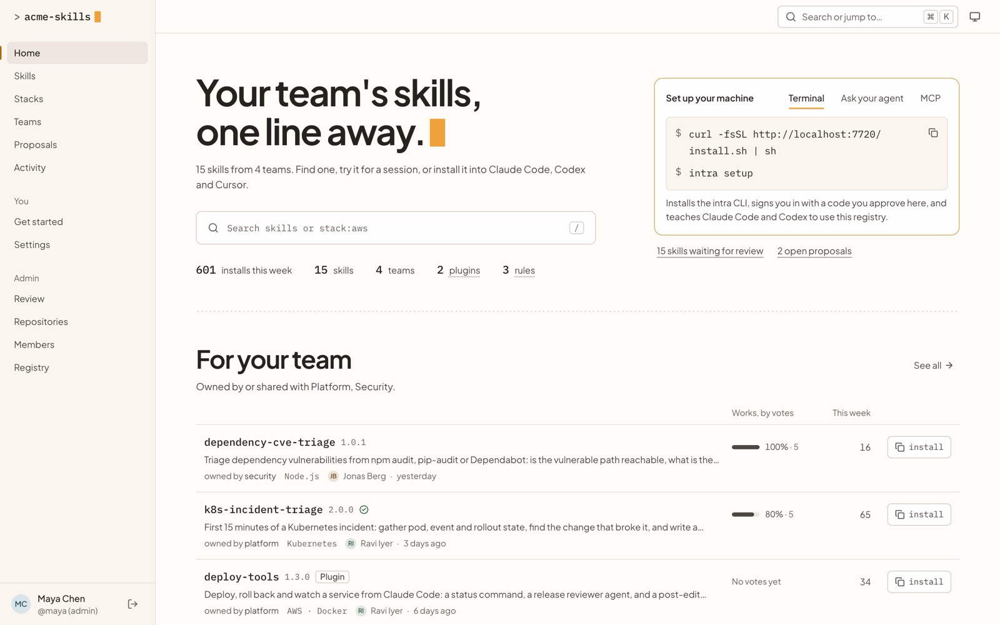
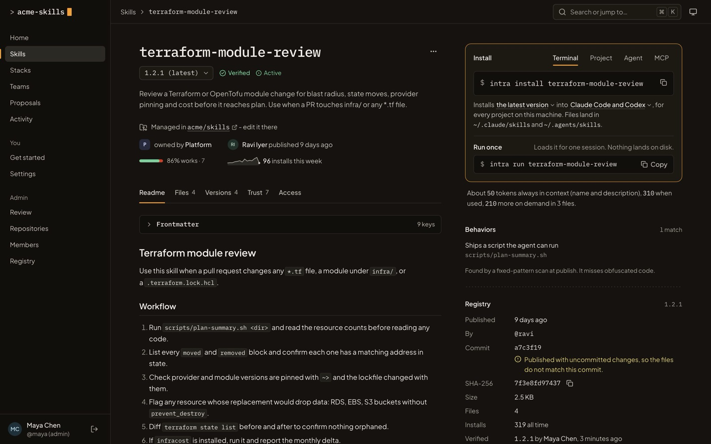
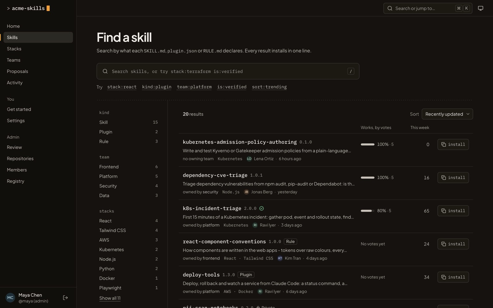
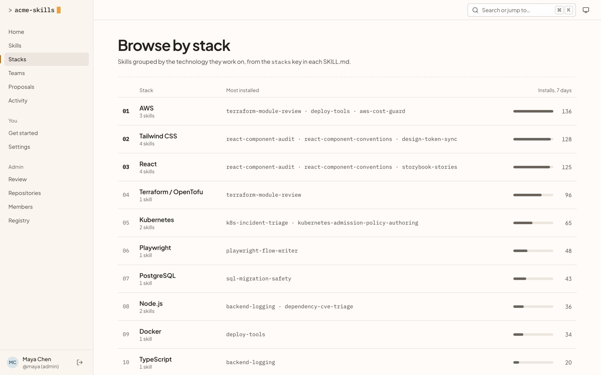
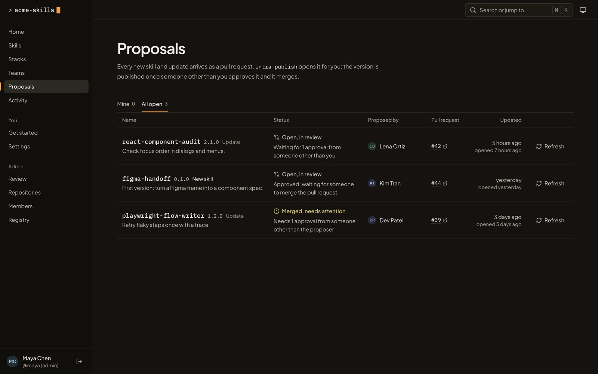
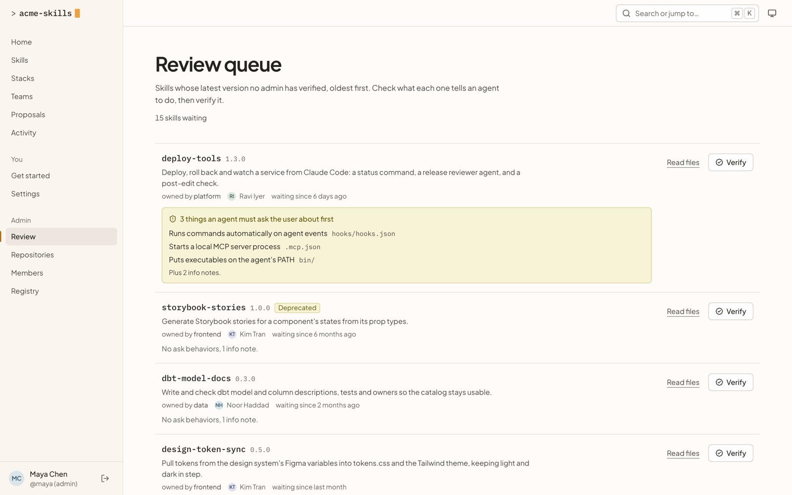
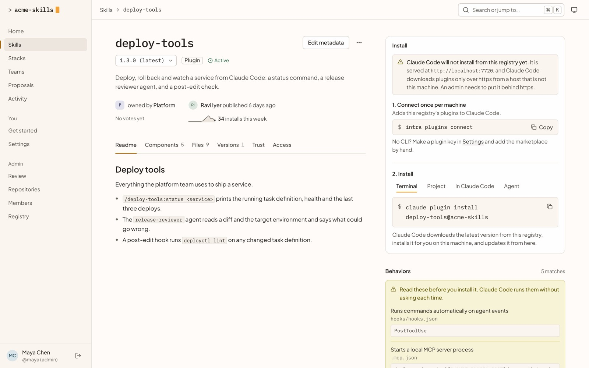
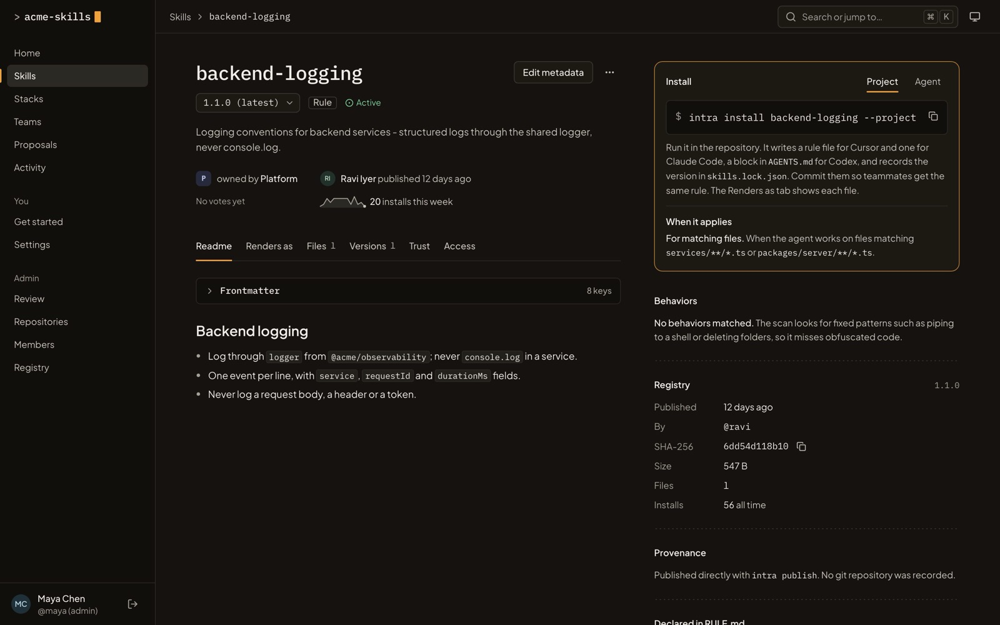

# intra-skills

**Your team's agent skills, one line away.**
intra-skills is an open-source, self-hosted registry for AI agent skills, Claude Code plugins and Cursor-style rules.
Teams publish what they have learned once, and everyone installs it into Claude Code, Codex and Cursor with one command, or by asking their coding agent to do it.

You run it on your own server: one container, one data directory, no other services.
Skills can live in your own GitHub or Bitbucket Cloud repository, where every new skill and every update is a pull request and an approved merge is what publishes it.



## Why intra-skills

- **Skills stay inside your company.** Your playbooks, runbooks and conventions are not published to a public directory. The registry runs on your network, and the only outside service it calls is the git host you connect.
- **Review is the gate, not an afterthought.** With a repository connected, nothing publishes until someone other than its author approves the pull request.
- **Easy for people and for agents.** `intra install <name>` for a person; a pasted sentence, a bootstrap skill or an MCP server for an agent.
- **You can see what a skill will make your agent do.** Every version is scanned at publish for risky behaviors, such as piping a download into a shell or reading credential files, and those are shown before anyone installs it.
- **Yours to change.** MIT licensed, plain TypeScript and SQLite.

## Features

| | |
|---|---|
| **One-line install for every tool.** Each package page leads with its install command, with tabs for the terminal, a project, your coding agent and MCP. The CLI installs into Claude Code, Codex and Cursor, or runs a skill for a single session without installing it. |  |
| **Search by what a skill declares.** Filter by kind, team, tech stack, work area and tool, straight from each `SKILL.md`. Type `stack:terraform is:verified` or press `Ctrl K` / `⌘ K` anywhere. |  |
| **Grouped by team and tech stack.** Teams own skills and collections; stacks rank the most-installed skills for each technology. |  |
| **Publishing through pull requests.** `intra publish` opens the pull request with the registry's own credential, so nobody needs git-host access on their laptop. The Proposals page says in plain words what each one is waiting for. |  |
| **Trust you can check.** Behaviors found at publish, admin verification, teammates' works and broken votes, immutable versions checked by sha256, and the git commit and pull request each version came from. |  |
| **Claude Code plugins.** The registry serves your org's plugin marketplace, so plugins install, version and update through Claude Code itself. Hooks, MCP servers and executables are flagged before install. |  |
| **Rules for every tool.** One `RULE.md` renders into `.cursor/rules`, `.claude/rules` and a managed block in `AGENTS.md`, and the "Renders as" tab shows each file. |  |

Also included: per-team collections that install in one line, `intra suggest` for the repository you are in, project lockfiles for CI, private skills with team and user grants, an activity log, and designed light and dark themes.

## Try the demo

You need Node 24 and pnpm.
The demo runs a fictional company, acme-skills, with 8 people, 4 teams, 15 skills, 2 plugins and 3 rules, and a few weeks of installs, votes and proposals.

```sh
git clone https://github.com/akshaymhetre/intra-skills.git
cd intra-skills
pnpm install
pnpm demo
```

Then open http://localhost:7720 and paste the token that `pnpm demo` prints.
It signs you in as Maya Chen, an administrator.
The guided tour and the other people to sign in as are in [docs/demo.md](docs/demo.md).
Stop it with `scripts/dev/down.sh`.

## Install for your company

The short version, on a Linux machine with Docker and a domain pointing at it:

```sh
git clone https://github.com/akshaymhetre/intra-skills.git
cd intra-skills
cp .env.example .env        # set INTRA_SKILLS_PUBLIC_URL and INTRA_SKILLS_DOMAIN
docker compose --profile https up -d --build
docker compose logs intra-skills | grep setup
```

Open the setup link from the log straight away and create the first administrator.
Caddy fetches the HTTPS certificate for you.

The full guide covers requirements, running behind your own proxy, backups, restores and upgrades: [docs/install.md](docs/install.md).

### Connect your skills repository

Optional, and recommended: with a repository connected, every new skill and every update becomes a pull request.

- [GitHub](docs/git-hosts/github.md), with a fine-grained token or a GitHub App, including GitHub Enterprise Server
- [Bitbucket Cloud](docs/git-hosts/bitbucket-cloud.md)

### Get your team started

Send each person the console's **Get started** page, or this line:

```sh
curl -fsSL https://skills.example.com/install.sh | sh && intra setup
```

It installs the CLI, signs them in with a code they approve in the browser, and teaches Claude Code and Codex how to use the registry.
Or they paste this into their coding agent:

> Set up our skills registry at https://skills.example.com for me. Read https://skills.example.com/agent.md first and follow it.

Setting up Claude Code, Codex, Cursor and MCP clients is covered in [docs/agents.md](docs/agents.md).

## Everyday use

```sh
intra search review --team platform --stack terraform
intra suggest                         # skills for the repo you are in
intra run pr-review                   # use it for this session; nothing lands on disk
intra install pr-review               # keep it, for Claude Code and Codex
intra install @platform/starter       # a team's collection, in one line
intra install pr-review --project     # copies plus skills.lock.json, committed with the repo
intra sync --frozen                   # a teammate or CI after a clone
intra update                          # stops and asks when a new version adds a risky behavior
```

Writing and publishing skills, plugins and rules: [docs/publishing.md](docs/publishing.md).

## How it is built

| Layer | Choice |
|---|---|
| Registry server | Node 24, Hono, the built-in `node:sqlite`; serves the API, the console, an MCP server and the CLI itself |
| Storage | One SQLite file; every file stored once by sha256, versions immutable |
| Git hosts | GitHub (token or GitHub App, Enterprise Server too) and Bitbucket Cloud, behind one provider interface |
| CLI | `intra`, TypeScript, shipped as one file the registry hands out at `/install.sh` |
| Console | React 19, React Router, Tailwind CSS 4, Vite |
| Deploy | One Docker image; Docker Compose with Caddy for HTTPS |

The repository layout and conventions are in [docs/architecture.md](docs/architecture.md), every setting in [docs/configuration.md](docs/configuration.md), and the HTTP API in [docs/API.md](docs/API.md).

## Develop intra-skills

You need Node 24 and pnpm.

```sh
pnpm install
scripts/dev/up.sh                          # a real registry on :7720, seeded with the demo org
pnpm --filter @intra-skills/web dev        # the console with hot reload on :5173
```

Checks:

```sh
pnpm check          # build, typecheck and unit tests across the workspace
scripts/e2e.sh      # the real server and CLI in a sandbox home directory
```

See [CONTRIBUTING.md](CONTRIBUTING.md) before opening a pull request.

## Status

intra-skills is young.
It is a complete, working product you can run today, but it has not yet been battle-tested in large deployments.

- GitHub publishing has been tested end to end against a real repository.
- The Bitbucket Cloud connector is built from Atlassian's published API and tested against recorded request shapes only, so run its **Test** button and one proposal before you rely on it.
- Cursor rules are rendered to Cursor's documented format but have not been checked inside the Cursor app.

Issues and pull requests are welcome.

## Licence

[MIT](LICENSE).
